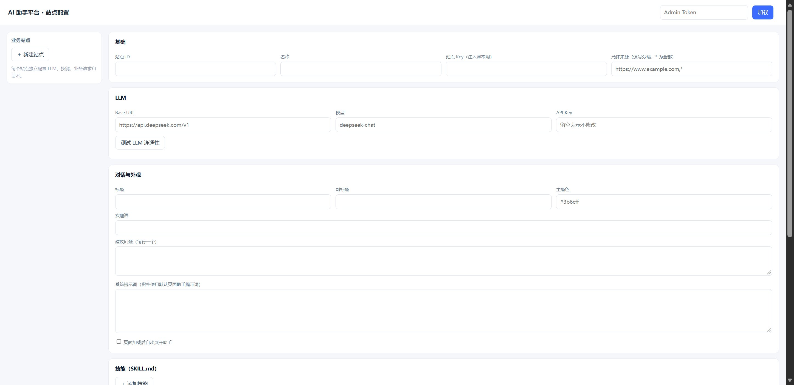
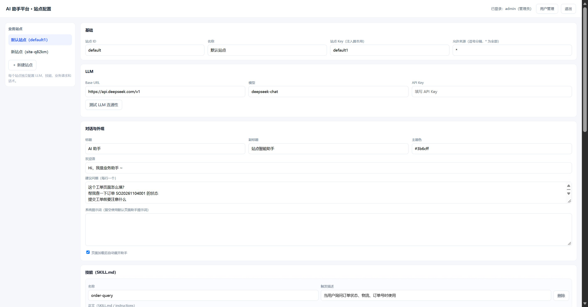
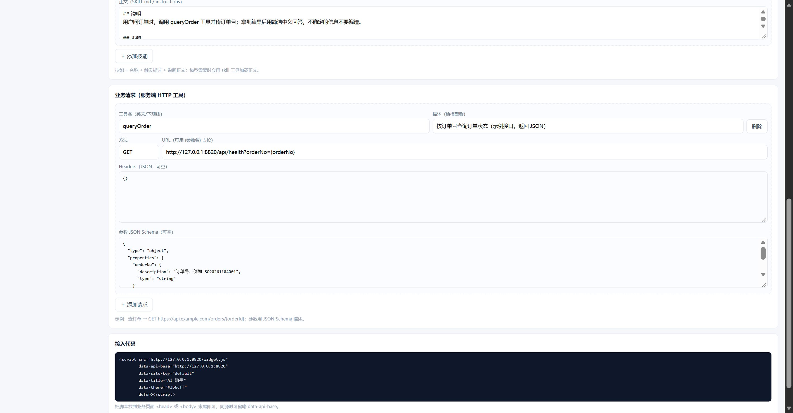

# 站内 AI 助手（KiKi 风格）

给任意网站加一个右下角浮窗 AI 助手：**看得懂当前页面、能替你点按钮填表单**，还带一个后台，可以按站点配置 LLM、技能、业务接口和话术。

前端是一个纯 JS 的 SDK（无需框架、无需构建工具链），后端是一个 Node 进程（SSE 流式 Agent）。
附带的**通用反代注入网关**可以让任意站点零改码接入——包括你没法改源码的第三方系统。

| 管理后台 | 登录与用户 | 技能 / 业务工具 |
| --- | --- | --- |
|  |  |  |

## 能力

**页面感知**

- 把当前页面序列化成带 `[ref=N]` 的无障碍树交给模型，模型只认 ref，不猜坐标
- `data-qca-ref` 让 ref 跨快照稳定，同一元素不会每次换号
- 增量读取：模型可以只要某一棵子树，省 token

**页面操作**

- `click / input / select / hover / scroll / goto / highlight / screenshot`
- 动作执行前读 `data-risk` 祖先：高风险动作（提交订单、删除）不自动点，改为高亮 + 要求用户确认
- 页面内跳转带 handover 票据，换页后对话不中断
- 连续多次同一动作 → 自动截图回传给模型，避免"点了没反应"的死循环
- 面板挂在浏览器的 **Top Layer**（`popover=manual`）并挂载在 `<html>` 下：站点把自己的弹窗 z-index 顶到 `2147483647`、或用原生 `<dialog>` 也盖不住它；body 被 SPA 整块替换时助手也不会丢

**后端**

- 多站点：每个业务站点独立配置 LLM（baseURL/model/key）、技能、业务 HTTP 工具、欢迎语、主题色
- 技能（Skill）：Markdown 描述 + 触发词，命中后注入到 system prompt
- 业务工具：把「查订单」「查监控状态」这类接口配成 HTTP 工具，模型可以带页面参数去调
- 用户与角色：`admin / editor / viewer`，scrypt 口令，HttpOnly Cookie
- 限流：按 IP 限制提问频率

**反代注入网关**（`deploy/gateway.mjs`）

- **动态模式，零配置**：URL 第一段就是目标域名，`http://host:3000/www.example.com/` 直接就是官网
- 一个端口挂所有站点，自动改写 HTML/CSS/URL、CDN 资源自动走 `_ext` 通道（自带 Referer 绕防盗链）
- 已处理：gzip/br 解压注入、CSP/HSTS 剥离、Cookie Domain 剥离、302 地址改写、Origin/Referer 改写、WebSocket 透传、配置热加载
- 内外网一视同仁，不需要白名单；IP 也可直接写（`/10.0.0.10:17000/`）

## 快速开始

```bash
# 1) 构建前端产物（src/sdk.js → public/widget.js）
npm run build

# 2) 起服务（默认 127.0.0.1:8820）
PORT=8820 HOST=0.0.0.0 npm start
```

- 管理后台：<http://127.0.0.1:8820/admin>
- 演示页面：<http://127.0.0.1:8820/demo>
- 健康检查：<http://127.0.0.1:8820/api/health>

首次启动会用环境变量创建管理员：

```bash
ADMIN_USER=admin ADMIN_PASSWORD='改成你的口令' npm start
```

登录后在「站点」里填 LLM 的 baseURL / model / apiKey 即可对话。

## 三种接入方式

### 1. 能改源码：直接加一行 script

```html
<script
  src="https://ai.example.com/widget.js"
  data-api-base="https://ai.example.com"
  data-site-key="www"
  data-title="官网助手"
  data-spa="false"
  defer
></script>
```

`data-spa="true"` 用于 Vue/React 这类前端路由站点（不拦截站内链接，路由变化时清空 ref）。

### 2. 不能改源码：反代注入（推荐）

```bash
cp deploy/gateway.config.json deploy/gateway.config.local.json
# 只需要改 assistant.base 指向你的助手服务，其它不用动
node deploy/gateway.mjs --config deploy/gateway.config.local.json
```

**动态模式，不用提前配置**——URL 第一段就是目标域名：

```
http://<网关>:3000/www.example.com/    →  https://www.example.com
http://<网关>:3000/m.example.com/      →  https://m.example.com
http://<网关>:3000/example.com/       →  https://example.com
```

**内外网一视同仁，没有例外**——内网系统也一样写，IP 带端口即可：

```
http://<网关>:3000/127.0.0.1:3001/     →  Kuma
http://<网关>:3000/10.0.0.10:17000/    →  夜莺
```

协议自动判断：带端口且不是 443/8443 按 http，其余按 https，失败自动换另一种。不需要白名单、不需要登记站点。

单站点体检（像浏览器一样请求一次，看有没有注入）：

```bash
npm run gateway -- --config deploy/gateway.config.local.json --probe www.example.com
```

### 3. 已有 Nginx / IIS

- Nginx：`deploy/nginx-ai.conf`
- IIS：`deploy/web.config`

思路都是把 HTML 响应对 `</head>` 做一次字符串替换，插入上面的 script 片段。

## 目录结构

```
.
├─ src/sdk.js              # 前端 SDK 唯一源码（末尾内联 html2canvas-pro vendor）
├─ public/                 # 构建产物 + 管理后台页面
│   ├─ widget.js           #   npm run build 生成，勿手改
│   ├─ admin.html          #   管理后台
│   └─ demo.html           #   演示页（可 ?site=xx&fresh=1）
├─ server.mjs              # 平台服务：管理端 + 运行时 Agent（SSE）
├─ build-widget.mjs        # 构建脚本
├─ shared/shot-policy.mjs  # 连续动作 → 自动截图 策略
├─ deploy/
│   ├─ gateway.mjs         # 通用反代注入网关
│   ├─ gateway.config.json # 网关配置示例
│   ├─ nginx-ai.conf       # Nginx 注入示例
│   └─ web.config          # IIS 注入示例
├─ examples/
│   ├─ site/               # 本地演练用的小页面（含订单/嵌套结构）
│   └─ skills/             # 技能示例
├─ test/shot-policy.test.mjs
└─ docs/                   # 逆向分析、部署说明、截图
```

## 配置一个业务站点

后台 → 站点 → 编辑，四个 Tab：

- **基础**：站点名、key、允许的来源域（CORS）
- **LLM**：baseURL / model / apiKey（OpenAI 兼容协议，深压、通义、vLLM 都行）
- **技能**：一个 Markdown，frontmatter 里写 `name / title / description / match`，`match` 是触发词正则
- **工具**：HTTP 工具，配 method / url / headers / 参数映射，模型可以带页面 ref 去调

技能示例见 `examples/skills/invoice-assistant/SKILL.md`。

## 部署

```bash
docker build -t site-ai-assistant .        # 见 docs/deploy.md
docker run -d --name ai-assistant \
  -p 8820:8820 \
  -e HOST=0.0.0.0 \
  -e ADMIN_USER=admin -e ADMIN_PASSWORD='***' \
  -v /opt/ai-assistant/data:/app/data \
  --restart=always site-ai-assistant
```

反代网关建议 `--network host` 跑（要回连 `127.0.0.1:8820` 的助手、`127.0.0.1:端口` 的内网系统）。

## 已知限制

- 页面感知基于无障碍树，`<canvas>`/WebGL 这类画布内容读不到，只能靠截图
- SPA 的根路径请求（`/socket.io/`、`/api/...`）用服务端 cookie 粘滞归还给当前站点，实测 Kuma 可用；但同一浏览器同时开多个站点标签时根路径请求会归到最后打开的那个
- 资源经网关代理后，`Referer` 会变成本站地址；开了防盗链的 CDN 需要在 `extHosts` 里声明
- 浏览器安全策略下无法模拟 `isTrusted=true` 的事件，个别框架的自定义组件可能不接受合成事件

## 文档

- [反代注入网关详解](docs/gateway.md)
- [部署说明](docs/deploy.md)
- [平台能力说明](docs/platform.md)
- [KiKi 逆向拆解](docs/kiki-replication.md) / [bundle 分析](docs/kiki-bundle-analysis.md)
- [图片能力调研](docs/image-capability.md)

## License

MIT。`src/sdk.js` 末尾内联了 [html2canvas-pro](https://github.com/yorickshan/html2canvas-pro)（MIT）用于视口截图，保留其原始版权声明。
